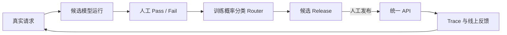

<div align="center">

<h1>RouteTune</h1>
<h3>用真实业务反馈，训练属于你的 LLM Router</h3>
<p>让每个请求去往“刚好够用”的模型，而不是让所有请求都支付最强模型的成本。</p>
<p><strong>私有化部署 · 安全脱敏 · 统一 API · 可追溯发布</strong></p>

<p>
  <a href="https://www.python.org/"></a>
  <a href="LICENSE"></a>
  <a href="https://github.com/HuggingAI/RouteTune/actions/workflows/ci.yml"></a>
  <a href="#统一-api"></a>
  <a href="docs/DEPLOYMENT.md"></a>
</p>

<p>
  <a href="#3-分钟本地体验">快速体验</a> ·
  <a href="#产品闭环">产品闭环</a> ·
  <a href="#私有化部署与安全可控">私有化与安全</a> ·
  <a href="docs/DEPLOYMENT.md">部署文档</a>
</p>

</div>

RouteTune 是一个开源、自托管的 LLM 路由闭环。它不依赖 LLM 再判断该调用哪个 LLM，也不要求你相信一套通用 benchmark：用自己的请求、候选模型真实输出和人工 `pass / fail` 反馈，训练并发布轻量概率分类 Router。

| 真实反馈驱动 | 私有化部署 | 安全可控 | 受控发布 |
|---|---|---|---|
| 用你的业务请求和人工判断训练，不被公共榜单定义 | 控制面、Router、Trace 与数据可部署在自己的基础设施 | 出站与返回双向脱敏，Key 不进入配置、Release 或 Trace | 草稿修改不影响生产，人工发布不可变版本并支持回滚 |

## 它解决什么问题

强模型通常更可靠，但不是每条请求都需要强模型。简单规则又很难表达真实业务中的质量边界。

RouteTune 将问题变成一个可持续学习的闭环：Router 输出固定能力层级及概率，Runtime 从该层模型池里选择低成本可用模型；失败时在同层回退，再升级到更高层。修改配置和训练模型不会直接影响生产流量，只有发布不可变 Release 后，统一 API 才会切换。

## 产品闭环



业务系统始终只面对一个 API。模型池、安全策略、训练数据和 Router Bundle 一起进入不可变 Release，因此每条线上决策都能还原“当时由哪个版本、以什么理由、调用了哪个模型”。

## 现在可以做什么

- 通过一个 OpenAI-compatible `/v1/chat/completions` 接入业务；
- 管理 OpenRouter、硅基流动、DeepSeek、MiniMax、LiteLLM 或自定义兼容 Provider；
- 将多个模型挂到固定路由层级，自动检测可用性并执行回退；
- 上传只要求 `messages` 字段的 JSONL，按路由模式或模型对比模式运行；
- 在统一审阅页查看 GT 和各模型输出，进行 `pass / fail` 标注；
- 用 Auto 或 TF-IDF + Logistic Regression 训练概率分类 Router；
- 创建不可变候选版本，人工发布或回滚生产版本；
- 查看模型分布、成功率、延迟、Input/Output Token 和完整 Trace；
- 在出站和返回阶段执行正则、词典及可选 spaCy 实体脱敏。

## 私有化部署与安全可控

RouteTune 可以运行在开发机、内网服务器或企业自己的云账号中。控制面、SQLite、Router artifacts、Trace 和标注数据都由部署方持有，不需要上传到 RouteTune SaaS。

| 接入方式 | 数据边界 | 适用场景 |
|---|---|---|
| 内部 LiteLLM / 私有模型服务 | RouteTune 和模型调用均留在私有网络 | 对数据出网有严格限制的业务 |
| OpenRouter、硅基流动、DeepSeek、MiniMax 等外部 Provider | RouteTune 数据留在本地，脱敏后的模型请求发往指定 Provider | 希望快速接入外部模型的团队 |

内置安全控制包括：

- 请求发送给 Provider 前执行敏感实体识别与脱敏；
- 模型返回后再次扫描，避免敏感内容进入业务响应；
- 支持正则、客户词典和可选 spaCy NER，并可按实体类型阻断；
- Trace 默认只存脱敏正文，也可切换为 `metadata_only`；
- Provider Key 通过环境变量或 `.env` 注入，不写入模型配置、Release 和 Trace；
- 生产配置遵循“草稿 → 候选 Release → 人工发布”，避免后台误操作直接改变线上路由。

> RouteTune 提供安全控制点，但不是完整 DLP、密钥管理或零信任平台。生产部署仍应配合 HTTPS、网络隔离、外部 Secret Manager 和访问控制。

## 3 分钟本地体验

只需要 Docker。默认启动三个本地 Mock 模型，不需要 API Key，也不会产生模型费用。

```bash
git clone https://github.com/HuggingAI/RouteTune.git
cd RouteTune
cp .env.example .env
docker compose up --build -d
```

打开 [http://127.0.0.1:8787/admin](http://127.0.0.1:8787/admin)，即可用内置样例走完“运行 → 审阅 → 训练 → 发布”。

```bash
curl http://127.0.0.1:8787/v1/chat/completions \
  -H 'Content-Type: application/json' \
  -d '{"model":"auto","messages":[{"role":"user","content":"请总结这份退款申请"}],"max_tokens":256}'
```

停止服务：

```bash
docker compose down
```

数据保存在 Docker named volumes 中；`docker compose down -v` 会一并删除这些数据。

## 统一 API

无论内部实际调用多少个 Provider，业务系统都只调用 RouteTune：

```text
POST /v1/chat/completions
model: auto
```

Playground 使用的也是这条统一 API，不存在只在后台才能运行的旁路逻辑。

## 配置真实模型 Key

所有 Provider 使用同一种方式：直接设置环境变量，或集中写进一个不提交到 Git 的 `.env` 文件。

```dotenv
OPENROUTER_API_KEY=...
SILICONFLOW_API_KEY=...
DEEPSEEK_API_KEY=...
MINIMAX_API_KEY=...
ROUTETUNE_API_KEY=change-me
```

Docker Compose 会在启动时自动读取根目录 `.env`。从源码运行时可以直接 `export`，也可以传入 `--env-file .env`。模型配置只保存环境变量名，不保存 Key 明文。

重启后，在“模型池”添加模型、选择 Provider 和路由层级，然后执行可用性检测。可以创建任意多个自定义 OpenAI-compatible Provider，并在多个模型间复用 Provider ID。草稿模型只有在创建并发布新 Release 后才会进入生产统一 API。

当已发布版本同时包含真实模型与 Demo Mock 时，RouteTune 优先选择已配置凭据的真实 Provider，Mock 只作无 Key 冷启动或最后兜底。`GET /health` 会返回 `provider_mode` 和每个层级的 `routing_targets`，便于确认真实流量会去哪里。生产环境建议禁用 Mock、设置 `ROUTETUNE_API_KEY`，并由 HTTPS 反向代理对外提供服务。

更完整的容器配置、备份和升级说明见 [部署指南](docs/DEPLOYMENT.md)。

## 从源码运行

需要 Python 3.11+ 和 [uv](https://docs.astral.sh/uv/)：

```bash
uv sync
cp .env.example .env
```

先在一个终端启动本地 Mock Provider：

```bash
uv run routetune mock-litellm --host 127.0.0.1 --port 4000
```

再在另一个终端启动 RouteTune：

```bash
uv run routetune bootstrap-labels \
  --output artifacts/bootstrap/label-bundle
uv run routetune serve \
  --label-bundle artifacts/bootstrap/label-bundle \
  --models configs/models.mock.toml \
  --env-file .env \
  --trace-db data/routetune.db
```

运行质量检查：

```bash
uv run ruff check .
uv run pytest
```

## 核心边界

RouteTune 的核心特色只有一个：

> 每个生产路由版本都来自真实业务数据和候选模型实测，并在人工确认后发布；每次线上决策都能追溯到当时的不可变版本。

因此，MVP 不尝试成为通用 LLM Gateway、完整 DLP、通用评测平台、Agent/RAG 平台或大型 LLMOps 套件。安全、Trace、审阅和版本管理都只服务于“让 Router 持续变好”这条主线。

当前版本定位为单机开源 MVP，使用 SQLite 和进程内后台任务，适合本地体验、团队试跑和单实例自托管。多副本部署所需的共享数据库、分布式任务与协调机制尚未实现。

## 文档

- [一页产品定义](docs/PRODUCT_ONE_PAGER.md)
- [核心技术与产品架构](docs/ARCHITECTURE.md)
- [部署指南](docs/DEPLOYMENT.md)
- [Engine 数据契约](docs/ENGINE_CONTRACT.md)
- [版本发布与扩缩容架构](docs/RELEASE_ARCHITECTURE.md)
- [企业试跑数据集](docs/ENTERPRISE_PILOT_DATASETS.md)
- [发布宣传素材](docs/LAUNCH_KIT.md)
- [首次开源发布清单](docs/RELEASE_CHECKLIST.md)

## 参与项目

欢迎提交 Bug、真实业务路由场景和小而明确的改进。开始前请阅读 [CONTRIBUTING.md](CONTRIBUTING.md)；安全问题请按 [SECURITY.md](SECURITY.md) 私下报告。

Apache License 2.0，详见 [LICENSE](LICENSE)。
