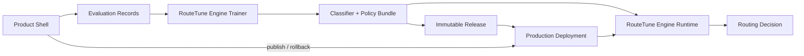
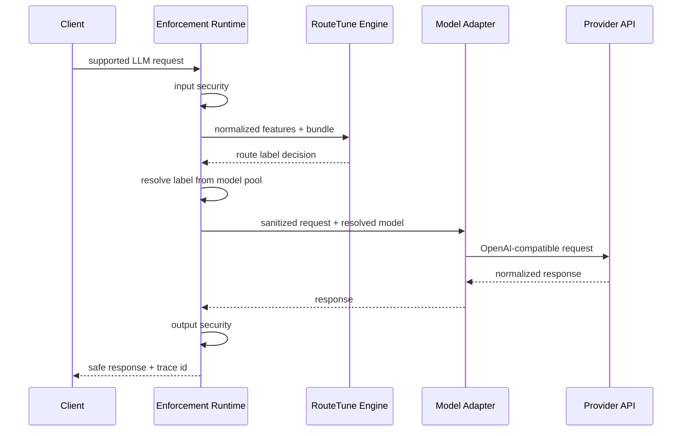

# RouteTune 精简架构

> 版本：v0.4
> 日期：2026-10-10
> 原则：核心技术独立；产品是一条闭环；草稿永不绕过发布影响生产。
>
> Release、Deployment 与多副本运行的规范见 [RELEASE_ARCHITECTURE.md](RELEASE_ARCHITECTURE.md)。

## 1. 架构核心

RouteTune 分成两部分：

```text
RouteTune Engine        可独立发展的核心技术
RouteTune Product       采集、标注、验证和部署 Engine 的最小产品
```

二者之间只通过版本化数据契约和模型/策略包连接。



## 2. RouteTune Engine

Engine 不依赖：

- HTTP 框架；
- Web UI；
- 数据库；
- 模型供应商 SDK；
- AI Gateway；
- Annotation 页面；
- Trace 存储实现。

### 2.1 Trainer

Trainer 消费冻结的 Evaluation Records。候选模型先映射到稳定的路由层级，训练目标是请求所需的最低合格层级，而不是某个供应商模型 ID：

```text
request
candidate model and route label
pass / fail annotation
optional score and failure reason
cost
latency
explicit constraints
```

输出：

- 固定层级分类器模型包（默认 `tier_1`～`tier_5`）；
- 概率校准参数；
- OOD/拒识配置；
- 质量阈值；
- 训练数据版本和指标。

Trainer 是插件边界，不是写死的一种算法：

```text
Probabilistic Classifier Contract
├── auto                  推荐入口，按样本和环境解析实际训练器
├── tfidf_logreg          MVP 可用，小数据冷启动与 CPU 部署
├── fasttext              后续本地训练器
└── bert / MiniLM         后续 Encoder 分类训练器
```

所有实现必须输出同一个 `LabelEngineBundle` 契约，并在 manifest 记录 `router_family`、`trainer_id`、数据指纹和训练样本数。产品可以推荐 `Auto`，但不能隐藏实际解析出的训练器，也不能展示尚不可运行的假选项。

Jev 等托管实现属于外部概率分类器适配器：只要能够返回固定标签的概率/置信度并遵守 fallback 契约，就可以接入 Runtime。它与 TF-IDF、FastText、BERT 的区别是模型与训练方式，不构成新的 Router 范式。

### 2.2 Runtime

Engine Runtime 接收标准化请求特征和不可变 Bundle，返回纯层级决策：

```text
selected_route_label
route_label_probabilities
confidence
ood_score
excluded_candidates
decision_reason
fallback
bundle_version
```

Engine Runtime 不执行 LLM 请求，也不写数据库。

### 2.3 Optimizer

MVP 只有一种优化目标：

```text
predict the lowest route_label
whose mapped models meet the quality threshold
```

Product Runtime 再把层级解析为实际模型：MVP 同层级内按 `cost_rank` 选择；调用失败先切换同层模型，再向更高层级升级。后续模型池选择器可在已发布规则下综合成功率、人工标注通过率、延时、健康和相对成本。模型增删和供应商变化不要求重训 Router。核心验证阶段不计算供应商特定美元价格。

## 3. Product Shell

Product Shell 只有四项职责：

```text
Collect    收集真实请求和候选模型结果
Annotate   标注输出是否合格
Validate   证明路由在质量门槛内节省成本
Deploy     将通过验证的 Bundle 发布到 Runtime
```

逻辑能力包括：

- 离线候选模型执行；
- 最小 Annotation；
- 数据集快照；
- 训练和评测任务；
- 质量—成本等级下放报告；
- Bundle Registry；
- 链路内 Enforcement Runtime；
- 最小 Trace 和回滚。

这些是产品能力，不进入 Engine 包。

## 4. 离线训练与评估链路

离线链路用于生成可发布的分类路由 Bundle：


报告必须比较：

- 固定高成本模型；
- 固定便宜模型；
- 当前人工规则；
- RouteTune；
- 理论 Oracle，仅用于判断可达到的上限。

公开 benchmark 只用于工程 smoke；真实效果由未来业务请求及人工标注验证。

成功输出必须由用户标注 Pass/Fail；超时、限流、空正文等技术失败自动作为失败候选进入训练，不要求人工标注，也不能阻塞训练入口。每条请求仍至少需要一个成功输出，避免用全链路故障生成无意义训练样本。

## 5. 在线链路

当前开源 MVP 以单进程模块化单体实现薄 Runtime：

在线契约固定为无状态单轮：输入 `messages` 只允许 `[user]` 或 `[system, user]`，输出一条 assistant response。MVP 不接受历史 assistant 消息，不保存或拼接会话上下文。



Enforcement Runtime 只负责：

- 支持协议的最小解析；
- 输入/输出安全；
- Engine 调用；
- 路由层级到模型池的解析与逐级回退；
- OpenAI-compatible Provider 转发；
- Trace 事件。

它不负责：

- 多供应商 SDK；
- 供应商负载均衡；
- 复杂业务重试；
- 熔断和配额平台；
- 完整 OpenAI API 兼容。

## 6. 安全边界

安全分成三个动作：

```text
log_redact        只保护持久化和查询
outbound_redact   发送给外部模型前替换
block             阻断或使用允许的 fallback
```

检测实现可组合：

- 正则与校验算法；
- 客户词典；
- spaCy Matcher/NER；
- 外部 DLP Adapter。

检测器只返回 `SensitiveFinding`，安全策略决定动作。安全实现是可替换的产品组件，不进入路由 Engine。

## 7. Annotation 边界

`Annotation` 专指人对某个模型输出的评价，Query 分类称为 Request Understanding。

MVP 数据：

```text
annotation_id
target_output_hash
request_id
candidate_model_id
schema_version
pass_fail
failure_reason optional
score optional
comment optional
annotator_id
created_at
```

输出内容必须不可变引用。Annotation 不直接修改线上策略，只能进入新的 Dataset Snapshot，重新训练、验证和发布 Bundle。

## 8. 最小 Trace

Trace 只承担可复现闭环：

```text
request
→ security
→ classification
→ route decision
→ actual model call
→ response reference
→ outcome / annotation
```

正文存储模式：

- `metadata_only`；
- `redacted`，默认；
- `encrypted_full`，经批准后使用。

Trace 不发展成通用日志平台。

每条 Trace 必须带 `request_source`。`api` 表示统一外部 API（包括 Playground），`batch` 表示内部候选执行。运行大盘默认只聚合 `api`，防止训练实验流量污染生产请求量、成功率、Token、延迟和模型分布；批次 Trace 仍完整保留给审阅与训练。

## 9. 当前部署形态

开源 MVP 只有一个在线进程和一个 SQLite 文件：

```text
routetune serve
├── /v1/chat/completions    请求入口
├── /v1/releases            不可变候选与版本历史
├── /v1/deployments         Production 活动版本
├── /v1/model-pool          模型池与层级映射
├── /v1/batches             JSONL 路由/对比批次
├── /v1/traces             Trace 查询
├── /v1/.../annotations    用户输出标注
├── /v1/stats              API/批次分源运行统计
├── /v1/router/trainers    可用训练器与外部 Router Engine 目录
├── /admin                 内置管理台
├── Engine                 纯分类路由
├── Security Pipeline      regex + dictionary + optional spaCy
├── Model Adapter          OpenAI-compatible providers / LiteLLM
├── Release Runtime        已发布 Router + 模型池 + 安全快照
└── SQLite                 draft + release + redacted trace + annotation
```

以下内容在出现真实规模需求前不引入：

```text
微服务拆分
消息队列和 worker
PostgreSQL
独立前端构建链
通用 Gateway / DLP / LLMOps 平台
```

逻辑能力不等于微服务。MVP 不拆分 Security、Trace、Annotation、Eval 等独立服务。

## 10. 依赖方向

```text
Product Shell
    ↓ uses contracts
RouteTune Engine
    ↓
Python scientific/runtime dependencies
```

Engine 不得反向导入 Product Shell。

外部系统统一通过 Product Shell 的 Ports 接入：

```text
Gateway Transport
Model Executor
DLP
Secret Store
Object Storage
Telemetry Exporter
```

## 11. 已实现边界

当前已实现：

```text
Draft data/config → candidate Release → manual publish → Production Deployment
                                                           ↓
HTTP → published security → published router → published model pool → Trace
                                                                    ↓
                                                       Admin UI → pass/fail
```

没有训练数据时，`bootstrap-labels` 生成冷启动 Bundle，启动配置会被自动固化为首个 Production Release。模型池和安全策略修改只进入草稿；训练对比批次或手动快照生成候选 Release，人工发布后统一 API 才切换。模型池可配置 `max_tokens`、`temperature`、`top_p`、`top_k` 默认值；统一 API 或批次可以覆盖，未配置的字段才交给 Provider 默认值。

模型可用性属于模型池运行状态，不属于发布配置。服务默认每 30 分钟串行探测启用且凭据完整的模型，使用最多 32 Output Token 的固定简单请求；探测不进入业务 Trace，也不产生并发探测风暴。手动检测和真实模型调用仍会即时刷新同一状态。运行统计始终分别保留 Input Token 与 Output Token。
