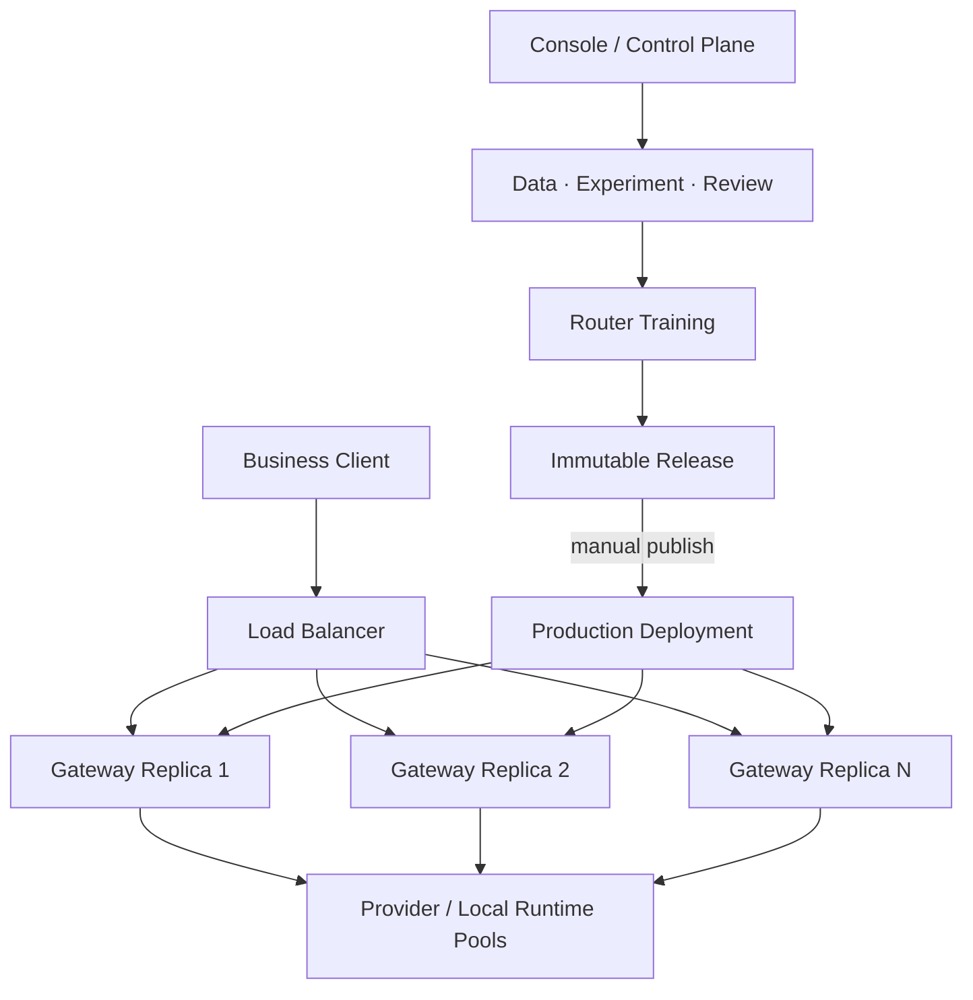

# RouteTune 生产架构与扩缩容路线

> 日期：2026-10-09
> 本文同时记录已经实现的生产生效边界和后续生产化方向。除“当前实现阶段”明确列出的能力外，其余扩缩容内容均为演进目标，不代表当前单机版本已经提供多副本或高可用能力。

## 1. 控制面与数据面



控制面允许频繁编辑。数据面只消费已发布的不可变 Release。二者可以在开源 MVP 中运行于同一个进程，但依赖方向和状态边界必须保持分离。

## 2. Release 内容

一个 Release 冻结：

- Router Bundle 及其版本；
- 固定标签体系和 fallback；
- 模型池、标签映射、成本顺序与可用状态；
- Provider Endpoint 和密钥引用；
- 安全词典快照与阻断策略；
- 来源批次、评测结果和发布说明。
- 模型池选择策略、权重、阈值和 fallback 顺序。

Release 不保存 API Key 明文。创建后禁止原地修改；任何变化都产生新的 Release。

## 3. 状态机

```text
candidate ──publish──> published ──next publish──> superseded
     ▲                       ▲                         │
     └──── new training      └──────── rollback ──────┘
```

回滚不会修改历史版本，而是把旧 Release 重新设为活动版本。生产环境任意时刻只有一个活动 Release。

## 4. 统一 API 的一致性

`/v1/chat/completions` 在一次请求开始时获取一个活动 Runtime 引用，并在整个请求中保持不变。发布可以并发发生，但进行中的请求继续使用旧版本，新请求使用新版本。

生产请求不能从草稿模型池动态查询配置。否则后台一次编辑会绕过评测和发布，破坏可复现性。

Trace 至少记录：

```text
deployment_id
release_id
bundle_version
selected_route_label
selected_model_id
actual_model_id
selector_policy_version
selector_reason
```

## 5. 模型池观测与动态选择

Router 与模型池选择器解决两个不同问题：

```text
Router: 请求需要哪个能力层级？
Pool Selector: 在该层级的合格模型中，本次具体调用哪个？
```

模型池按模型及路由层级展示：请求数、成功率、人工标注通过率、平均/p50/p95 延时、错误率、可用率、fallback 率。成功率必须同时显示样本量，低样本数据不能直接支配选择。

动态选择遵循以下边界：

1. 先执行硬条件过滤：已启用、健康、层级匹配、能力标签匹配和安全约束；
2. 再由已发布的选择策略综合质量、延时、健康度和稳定的相对成本等级打分；
3. 策略公式、权重、最低样本阈值和 fallback 顺序属于 Release，必须经过候选评测与发布；
4. 成功率、延时和健康状态是可实时更新的观测输入，不要求每次更新都发布；
5. 每个 Trace 保存当时的指标快照版本、候选得分和最终选择原因；
6. 新模型和低样本模型只能在受控探索配额内获取流量，避免早期噪声和反馈回路锁死选择。

因此，运行指标可以动态变化，但它们不能绕过发布流程修改 Router 或选择规则。

## 6. 水平扩缩容

Gateway 必须保持无状态：

- Release 在本地以内存形式加载；
- 活动版本指针存放在共享数据库；
- 每个实例轮询或订阅版本变化并原子替换 Runtime；
- 请求链路不依赖管理后台进程内状态；
- Trace 采用异步写入接口，生产部署可替换为消息队列；
- 健康检查区分进程存活和 Release 就绪。

模型执行池分两类：

- 外部 Provider：RouteTune 管理并发、限流、健康和降级，不负责供应商自身扩容。
- 本地 Runtime：同一逻辑模型可注册多个实例，由执行池做健康检查和负载分配；TokenRouter 可作为一个本地 Runtime 接入。

MVP 使用 SQLite 和单进程原子切换验证语义；生产扩展目标是 PostgreSQL、共享对象存储、异步 Trace 和多个 Gateway 副本。升级基础设施不能改变 Release 与 Deployment 契约。

## 7. 当前实现阶段

第一阶段已建立：

- 不可变 Release 存储；
- `production` Deployment；
- 初始配置自动形成首个已发布版本；
- 训练结果自动注册为候选版本；
- 手动发布和历史版本重新发布；
- 生产 Runtime 使用模型池与安全策略快照；
- Trace 绑定 Deployment 和 Release。

后续阶段补充模型池指标面板与动态选择器、评测门禁、独立 Experiment 对象、发布审批、就绪探针、跨实例通知和真正的异步 Trace Writer。
